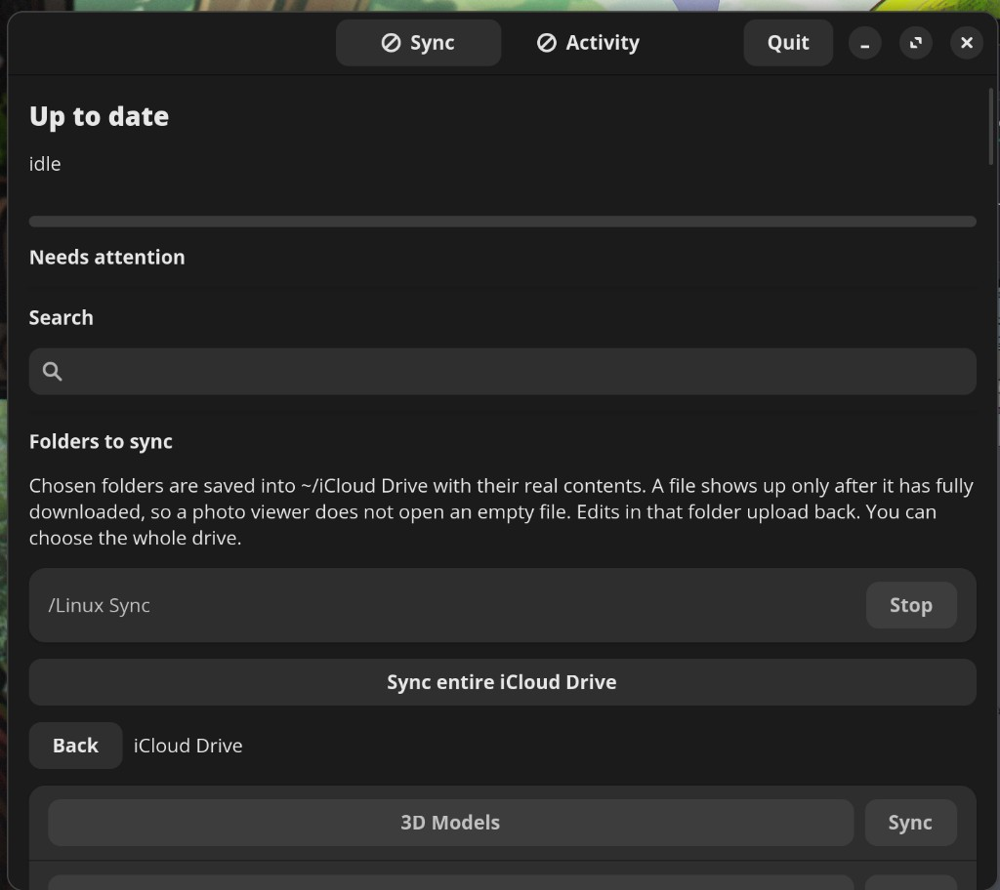

# iCloud Drive for Linux

A Linux client for iCloud Drive. You choose the folders to keep on this computer. Those files are saved into `~/iCloud Drive`, a normal folder you can bookmark in the file manager. The folder stays put when you quit.

Sign-in happens in a small GTK window. A background service owns the filename index and the transfers. The window and a panel icon show what that service is doing.



This uses the same web API as iCloud.com. Apple does not publish that API, and they can change it.

## What you can do

- Choose which folders to keep on this computer. **Sync entire iCloud Drive** downloads everything. A chosen folder's files are saved into `~/iCloud Drive`, and edits there are uploaded.
- Search by filename. From a result, choose **Keep downloaded** and that one file is saved into `~/iCloud Drive`.
- Bookmark `~/iCloud Drive` in the file manager. Quitting the app leaves the folder and the files already saved there.
- Sign in, enter a verification code, accept updated terms, or approve Advanced Data Protection from the window.
- Watch a sync or a single-file transfer on a progress bar, on the panel icon, and in one notification that updates in place.
- Open the **Activity** tab for recent downloads, uploads, local edits, folder choices, renames, moves, and conflicts.
- Resolve a conflict, retry a transfer that stopped, or dismiss a file Apple no longer has. Those actions wait for you.
- **Start** and **Quit** in the window start and stop the background service. The panel icon has **Open** and **Quit**.

The folder is `~/iCloud Drive` unless you set another path.

## How a file gets here

The service lists the top of iCloud Drive and stops there. That listing is the folder names in the window. It does not open those folders, and it does not download file contents.

After you choose a folder, the service lists that folder and the folders inside it, then downloads the files. **Sync entire iCloud Drive** lists and downloads the whole drive. The line under the progress bar shows the folder being listed. Later checks compare those names.

A chosen folder is saved into `~/iCloud Drive` using the same folders as iCloud. A download in progress stays under `~/.cache/icloud-drive/blobs` and is moved into place only when it finishes, so a photo viewer opens the finished file. Stopping a folder removes local copies you have not edited. The names stay in the search index. A file you add or edit in the folder is uploaded on the next check.

One transfer runs at a time, and it can be cancelled. Listing a chosen folder continues between downloads. An empty iCloud file is saved only after Apple returns an empty body. A listing that omits the size is downloaded rather than treated as an empty file.

The service asks Apple again about every five minutes. iCloud does not push changes to this client, so an edit from a phone shows up on the next check, or when you run `icloud-drive sync`. That refresh updates names. It downloads file contents for the folders you have chosen.

## Sign-in

The password is used to complete sign-in and then cleared. It is not written to the config file or the session file. The session is stored at `~/.local/state/icloud-drive/session.json` with mode `0600`.

A normal trusted session lasts on the order of two months. With Advanced Data Protection on, Apple can ask a trusted device to approve web access much more often, sometimes about every eight hours. The window has a step for that approval, for an SMS code, and for a code shown on a trusted device.

The command line never asks for a password. `status`, `search`, `pin`, `unpin`, and `sync` talk to the service that is already running. If the session has expired, the service stays up and the window says sign-in is needed.

Accounts on iCloud in mainland China can set `china = true` in the config so sign-in uses Apple's China hosts.

## Saving and deleting

Deleting a synced file from iCloud is refused until you turn on **Allow deletion**. The switch is off by default, and the choice is saved. With it on, a delete is sent to the iCloud trash. If Apple rejects it, the item stays queued and the window says the delete failed.

Editing a file in a synced folder is a normal save. The service notices the new size and uploads it. With deletion off, removing the file from disk does not remove it from iCloud.

## When the two sides disagree

A finished folder listing is the only thing that may drop a name from the index. The name is removed when Apple no longer lists it, the listing completed, and the local file has no unsaved edits. A listing that times out or fails is reported in the window and does not empty the folder.

If you edited a file that Apple no longer has, it becomes a conflict. The window can keep your copy, keep theirs, or keep both. Keep both writes a separate local file, so the two copies do not share one blob.

A download or upload that stops short of the expected size stays in the same list, with retry and discard. A document id Apple says is gone is remembered, so the service does not retry it forever. Refresh in the window clears that and asks the service to look again.

## The panel

The icon is a StatusNotifierItem. COSMIC and KDE show that in the status area. On GNOME it appears where AppIndicator is installed. The icon stays visible while the service is running. It draws a progress ring during a download or upload, and the notification carries the same percent. Clicking the icon opens the window. Right-click it for **Open** and **Quit**.

**Quit** stops the service and leaves the window open, so **Start** can run it again. `~/iCloud Drive` and the files already saved there stay on disk. The service can also start again at the next login when the user unit is enabled.

## Install

You need Rust (stable) and the GTK 4 and libadwaita development packages.

```bash
sudo apt install libgtk-4-dev libadwaita-1-dev pkg-config build-essential
cargo build --release
```

Run it by hand:

```bash
./target/release/icloud-drive daemon
./target/release/icloud-drive-gui
```

Or install the user service:

```bash
sudo install -m 0755 target/release/icloud-drive target/release/icloud-drive-gui /usr/bin/
install -D -m 0644 packaging/icloud-drive.service ~/.config/systemd/user/icloud-drive.service
install -D -m 0644 packaging/icloud-drive.desktop ~/.local/share/applications/icloud-drive.desktop
systemctl --user daemon-reload
systemctl --user enable --now icloud-drive.service
```

The window has **Start when you log in**. That writes an autostart entry which launches the window hidden and starts sync. The panel icon opens the window. If sync stops on its own, the window opens and a notification tells you to press **Start**. **Quit** stops sync without that alert.

A Flatpak bundle is attached to the [GitHub release](https://github.com/taylorhayis/icloud-drive-for-linux/releases). It uses the same window and saves into the real `~/iCloud Drive` folder. The first launch asks you to sign in again. Later launches reuse that session.

```bash
flatpak install --user icloud-drive-0.2.0.flatpak
```

Logs:

```bash
journalctl --user -u icloud-drive.service -f
```

`icloud-drive logs` prints the same journal.

## Commands

| Command | What it does |
| --- | --- |
| `icloud-drive daemon` | List iCloud Drive and keep chosen folders in `~/iCloud Drive` |
| `icloud-drive status` | Show the current phase and anything that needs you |
| `icloud-drive search notes` | Search the local filename index |
| `icloud-drive pin PATH` | Keep a file or folder downloaded |
| `icloud-drive unpin PATH` | Stop keeping it downloaded and remove the local copy |
| `icloud-drive sync` | Ask the service to check iCloud now |

## Config and data

Optional file: `~/.config/icloud-drive/config.toml`

```toml
mount_point = "/home/you/iCloud Drive"
allow_deletion = false
poll_seconds = 300
china = false
```

`mount_point` is the folder chosen files are saved into.

| Path | What it holds |
| --- | --- |
| `~/.local/share/icloud-drive/index.sqlite3` | Names, chosen folders, the activity log, conflicts, and the trash queue |
| `~/iCloud Drive` | Folders you chose to sync, and files you added. This folder is not removed on quit |
| `~/.cache/icloud-drive/blobs` | A download in progress, removed once the file is in place |
| `~/.local/state/icloud-drive/session.json` | The signed-in session, mode `0600` |

## Layout

The workspace is split so the Apple protocol, the sync rules, and the window can change separately.

| Crate | Role |
| --- | --- |
| `icloud-proto` | Sign-in and the Drive web calls |
| `icloud-engine` | The index, chosen folders, uploads, and the rules that avoid losing a file |
| `icloud-ipc` | The D-Bus API the window and the command line share |
| `icloud-cli` | `icloud-drive`, the service, and the panel icon |
| `icloud-gui` | The GTK 4 / libadwaita window |

## License

MIT. See [LICENSE](LICENSE).
